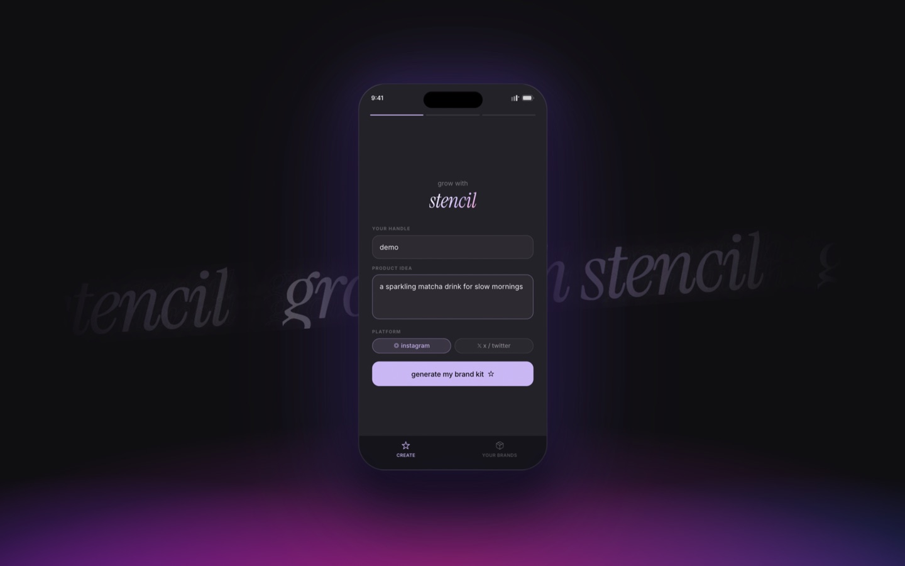
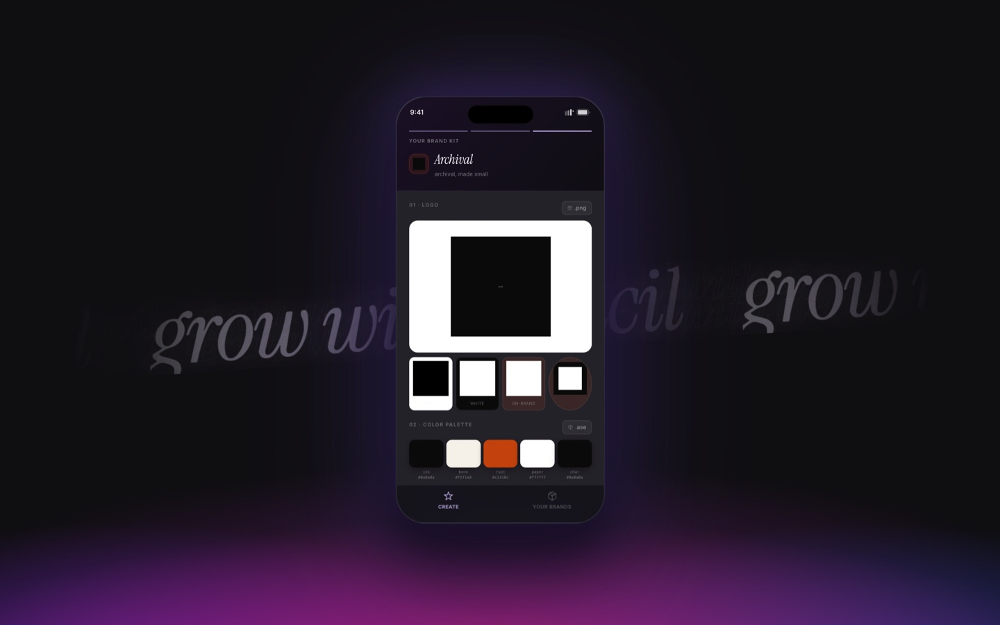
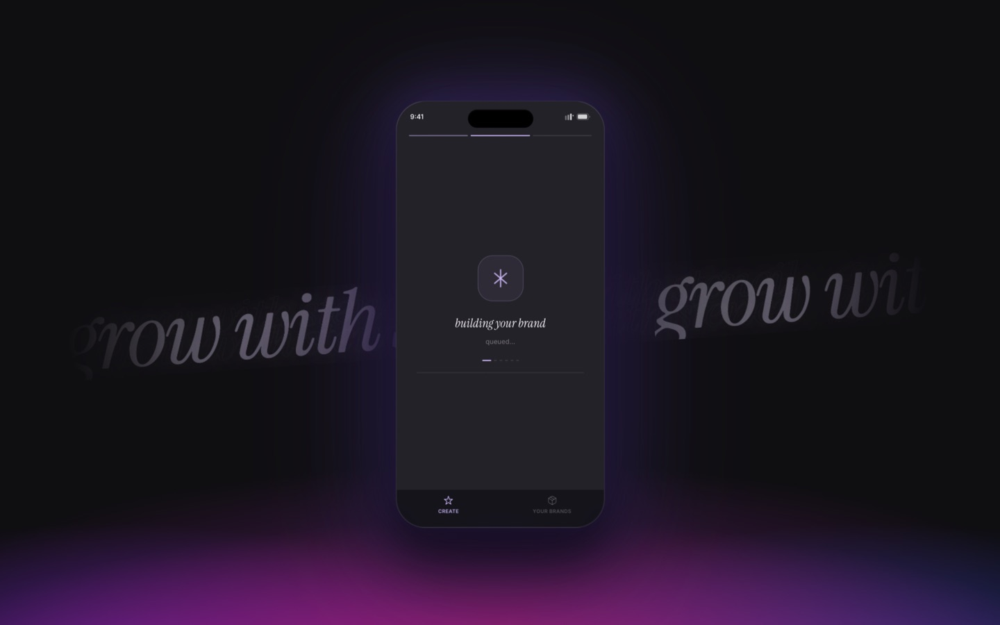
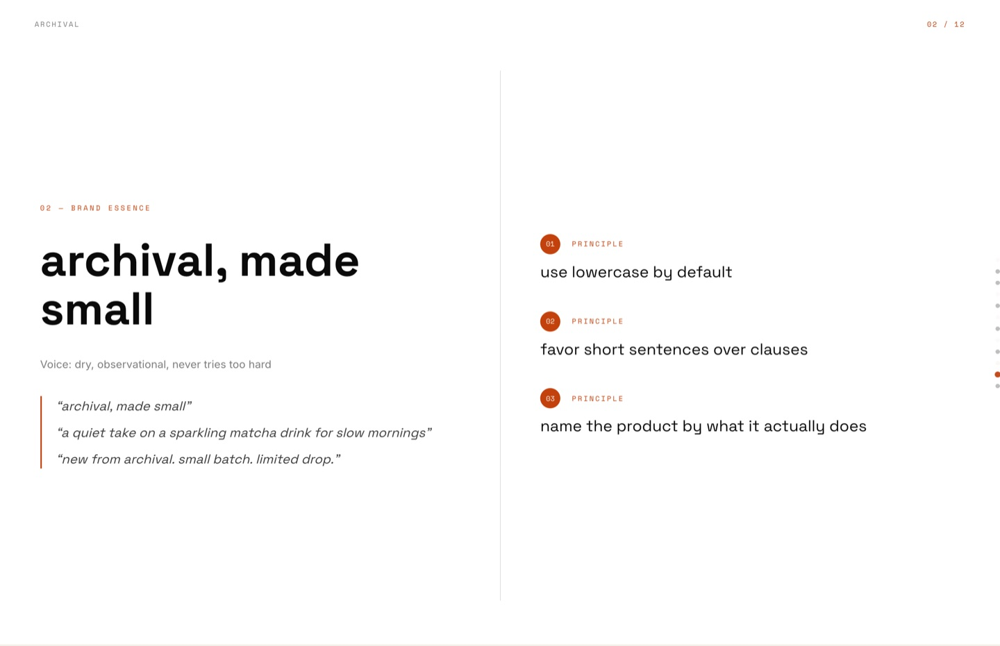

# Stencil — Collaborative Hackathon Project

**First Place — NYU Hackathon**

> **This is a team project.** This repository is my attributed GitHub fork of the
> original team repository, **[LKRamen/eeg-hackathon](https://github.com/LKRamen/eeg-hackathon)**.
> Stencil was built by five people (see [Team](#team)). I did not build it alone, and
> the full commit history with every original author is kept here unchanged.
> The only changes in this fork are listed under [Changes in this fork](#changes-in-this-fork).

Stencil turns a creator's social handle and a product idea into a starter brand
kit: an audience persona, a brand name and tagline, a logo set, a color palette,
type pairing, brand voice rules, merch mockups, social posts and captions, and a
shortlist of design agencies and creators to work with.

It was built in roughly 24 hours. Parts of it are real, parts are demo scaffolding;
this README says which is which.

<p align="center">
  
  
</p>

*Screenshots from a local run with no API keys, so the logo is the Pillow
placeholder and the persona comes from a fixture. With keys, Claude writes the
brand and Cloudflare Workers AI draws the images.*

---

## What it does

**Who it is for:** creators with an existing audience who want to launch a
product (merch, a drink, a small consumer brand) and need a first brand identity
that fits the people who already follow them.

**User journey**

1. On the home page, an interactive phone shows the app. You enter your handle,
   describe the product, and pick Instagram or X.
2. The API starts a job and the phone shows live progress:
   *scraping → synthesizing → generating → matching → exporting*.
3. The finished brand kit appears in the phone: logo variants, palette, type,
   voice do's and don'ts, tee and tote mockups, and ready-to-post captions, with
   per-asset download buttons.
4. `/jobs/<id>` shows the same result as a 12-slide brand deck (identity, essence,
   logo suite, color, type, graphic language, merch, editorial direction,
   cross-platform, captions, agency matches, motion and retail).
5. Finished kits are saved in the browser under **Your brands**.

## Feature status

Verified by running the app locally on 2026-11-19 (see [Testing](#testing)).

| Feature | Status | Notes |
|---|---|---|
| Handle + idea input, job creation, progress polling | Working | `POST /jobs`, `GET /jobs/{id}`, 1.5 s polling |
| Audience scraping, Instagram | Working with setup | Reads the Instagram session cookie from your local Chrome/Firefox profile and calls Instagram's web endpoints. Falls back to a minimal profile when no session is found. Hackathon-grade; may break or conflict with platform terms. |
| Audience scraping, X | Working with setup | `twscrape` with a real X account (`X_*` env vars) |
| Persona synthesis | Working with key | Claude Haiku; fixture persona without `ANTHROPIC_API_KEY` |
| Brand name, tagline, palette, typography, voice | Working with key | Claude Haiku, with retries and deterministic fallbacks |
| Logo set, tee/tote mockups, social posts | Working with key | Cloudflare Workers AI FLUX.1 schnell; Pillow renderer without keys |
| Agency matches | Working | Keyword overlap against a 10-agency fixture of fictional studios, with Claude-written reasons when a key is set. The deck's "embedding similarity" label predates the switch to keyword matching. |
| Creator (influencer) matches | Working with key | Claude ranks accounts from the scraped following list |
| Brand deck at `/jobs/<id>` | Working | 12 slides rendered client-side |
| Per-asset downloads, "Your brands" library | Working | Library is stored in `localStorage` only |
| Printable brand guide PDF | Partial | The live pipeline returns a placeholder URL. Python (WeasyPrint) and Node (`/api/export`, Puppeteer) exporters exist but are not wired into the pipeline. |
| Canva editable kit | Partial | Code path exists; skipped unless Canva Connect credentials and template IDs are set. Not verified. |
| Supabase persistence | Optional | Without credentials, jobs live in memory and images are served from `apps/api/cache` |
| Demo cache mode | Working | `CACHE_MODE=true` + `DEMO_HANDLE` replays a saved result |

## Architecture

```
 Next.js 14 web app (apps/web)                  FastAPI (apps/api)
 ┌──────────────────────────────┐  POST /jobs   ┌──────────────────────────────────────┐
 │ phone-app.tsx input/progress ├──────────────►│ routers/jobs.py → BackgroundTask     │
 │ BrandKitSlides 12-slide deck │◄──────────────┤ services/pipeline.py                 │
 │ /api/export (PDF, unwired)   │ GET /jobs/id  │   scraper → persona → brand.assemble │
 └──────────────────────────────┘  (polling)    │   → matching + influencers → export  │
        shared types:                           └───────┬───────────────┬──────────────┘
        packages/types ⇄ models/schemas.py              │               │
                                                 Claude Haiku    Cloudflare Workers AI
                                                 (text)          (FLUX images) / Pillow
                                                        │
                                                 Supabase (optional) or in-memory + /static
```

- **Frontend:** Next.js 14 App Router, React 18, TypeScript, Tailwind,
  shadcn/ui primitives, SWR.
- **Backend:** FastAPI, Pydantic v2, pydantic-settings, Anthropic SDK, httpx,
  Pillow, NumPy, Jinja2 + WeasyPrint, instaloader / browser-cookie3, twscrape.
- **Contract:** `packages/types/index.ts` mirrors `apps/api/models/schemas.py` by
  hand. `apps/api/tests/test_contract.py` now checks they stay in sync.
- **Naming:** "Halo" was the placeholder name in the build plan (`start.md`) and
  still appears in package names (`@halo/web`, `@halo/types`) and the API title.
  The product shipped as **stencil** in the UI. Code names were left as they are.
- **Leftovers from the original plan:** `requirements.txt` lists Replicate and
  Apify, some files are still named `_openai_client.py`, and `package.json`
  includes Three.js and Konva for components (`phone-3d-scene.tsx`,
  `MockupCanvas.tsx`) that nothing imports. The running code uses Anthropic and
  Cloudflare.

## Running it locally

**Prerequisites:** Node 20+ (tested on 22), pnpm 9, Python 3.11 to 3.13 (tested
on 3.13).

```bash
pnpm install

python3 -m venv apps/api/.venv
source apps/api/.venv/bin/activate
pip install -r apps/api/requirements.txt

cp apps/api/.env.example apps/api/.env   # optional: add any keys you have
```

Run each in its own terminal, **from the repository root** (the API uses
package-relative imports, so `cd apps/api && uvicorn main:app` does not work):

```bash
pnpm dev:api     # http://localhost:8000  (needs the venv active)
pnpm dev:web     # http://localhost:3000
```

Health check: `curl http://localhost:8000/health` → `{"ok":true}`

Production build of the web app: `pnpm build:web`, then `pnpm --filter @halo/web start`.

**No keys at all?** The default mode still runs end to end with fixture and
Pillow fallbacks. For canned data with no scraping attempts, start the API with
`USE_STUBS=true pnpm dev:api`.

### Environment variables

Set in `apps/api/.env` (see [`apps/api/.env.example`](apps/api/.env.example)).
All are optional.

| Variable | Used for |
|---|---|
| `ANTHROPIC_API_KEY` | Persona, brand text, match reasons, creator matches |
| `CF_ACCOUNT_ID`, `CF_API_TOKEN` | Image generation (Cloudflare Workers AI) |
| `SUPABASE_URL`, `SUPABASE_SERVICE_KEY` | Job table and asset storage (`apps/api/migrations.sql`). The service key is a server secret; never expose it to the browser. |
| `CANVA_CLIENT_ID`, `CANVA_CLIENT_SECRET`, `CANVA_SOCIAL_TEMPLATE_IDS`, `CANVA_MOCKUP_TEMPLATE_IDS` | Optional Canva kit |
| `CACHE_MODE`, `DEMO_HANDLE` | Replay a cached demo result |
| `USE_STUBS` *(shell)* | Run the pipeline on stub data |
| `X_USERNAME`, `X_PASSWORD`, `X_EMAIL`, `X_EMAIL_PASSWORD` *(shell)* | X scraping account |
| `NEXT_PUBLIC_API_URL` *(web)* | API base URL, default `http://localhost:8000` |

## Testing

```bash
pip install -r apps/api/requirements-dev.txt
pnpm test:api              # API smoke + contract tests, no keys or network needed
pnpm typecheck:web
pnpm lint:web
pnpm build:web
```

Results on 2026-11-19 (macOS, Node 22.21, pnpm 9.0, Python 3.13):

- `pnpm install --frozen-lockfile`: OK. `pip install -r requirements.txt`: OK.
- `pnpm test:api`: **25 passed** (health, job lifecycle, 404, 422 validation,
  TypeScript ⇄ Pydantic field parity for every shared model).
- `pnpm typecheck:web`: OK. `pnpm lint:web`: OK, 2 `exhaustive-deps` warnings.
  `pnpm build:web`: OK.
- API boots with no keys; `/health` returns ok; a job runs to `done` in both
  stub and default (keyless fallback) modes.
- Browser run of the real UI: input → progress → brand kit, then the 12-slide
  deck at `/jobs/<id>` (screenshots above and below).
- **Not verified:** live Claude, Cloudflare, Supabase, Canva or scraping runs,
  and PDF export. No credentials were used for this fork.
- The team's original phase tests in `apps/api/_dev/` predate the switch from
  OpenAI to Claude: 21 pass, 8 fail, and `test_visuals.py` is a script that does
  not import under pytest. They are kept as they were.

<p align="center">
  
  
</p>

## Known limitations

- The brand guide PDF in the live pipeline is a placeholder link (see feature table).
- Instagram scraping depends on the developer's own logged-in browser session
  and unofficial endpoints. Treat it as a demo technique, not a production
  integration.
- Without Supabase, jobs are lost when the API restarts, and image URLs point to
  `http://localhost:8000/static/...`, so the keyless mode only works locally.
- No authentication or rate limiting on the API; every job is created as `anon`.
- The repo has no license file, so the code is not open-licensed for reuse.

## Team

Stencil was designed and built by:

| Contributor | GitHub | Work visible in the commit history |
|---|---|---|
| Layth Rahman | [@LKRamen](https://github.com/LKRamen) | Created the repository; visual asset generation (logos, mockups, social kit); move to Cloudflare Workers AI; deployment fixes |
| Vivian | [@vivianknee](https://github.com/vivianknee) | Scraping pipeline, persona synthesis, agency matching; switch to Claude; real brand generation; image prompt design; influencer matching; logo slide |
| vin124 | [@Vin124](https://github.com/Vin124) | Monorepo scaffold and build plan; brand orchestrator and palette/type/voice wrappers; exports (brand guide, pitch deck, web guide, mfg spec, ZIP); contract sync; stub mode; demo cache |
| Maria Showalter | [@Mariaareadne1](https://github.com/Mariaareadne1) | Pydantic schemas and shared TS types; FastAPI scaffold and Supabase helpers; job endpoints and stubbed pipeline; input page; results page with polling; social captions and agency match slides; download buttons; loading screen |
| Justine Mach | [@justinemach](https://github.com/justinemach) | Animated phone hero; marketing layout; "Your brands" library tab |

The last column summarizes each person's commits. It is not a full account of
who did what during the event. Original repository:
<https://github.com/LKRamen/eeg-hackathon>.

## Hackathon

Built at an NYU hackathon in April 2026, where the team won **first place**.
The plan the team worked from is in [`start.md`](start.md); the visual-assets
brief is in [`person3_visual.md`](person3_visual.md).

## Changes in this fork

Forked from `LKRamen/eeg-hackathon` at commit
[`b7125be`](https://github.com/LKRamen/eeg-hackathon/commit/b7125be58a8f41247b0944e62408d4f99eab19cc).
History up to that commit is unchanged. Changes since:

- This README and the screenshots in `docs/media/`.
- `apps/api/.env.example`, rebuilt from the variables the code actually reads.
- `fix(web)`: two components ignored `NEXT_PUBLIC_API_URL` for relative asset URLs.
- `fix(types)`: `BrandResult` in `packages/types` gained `influencer_matches` and
  the Canva fields the API already returned.
- `test(api)`: keyless smoke and contract tests in `apps/api/tests/`.
- `chore`: removed a dangling `eeg-hackathon` gitlink, a stray pip log
  (`apps/api/=0.40.0`), a 3-byte `test-image.png`, and a machine-local
  `.claude/settings.local.json`.
